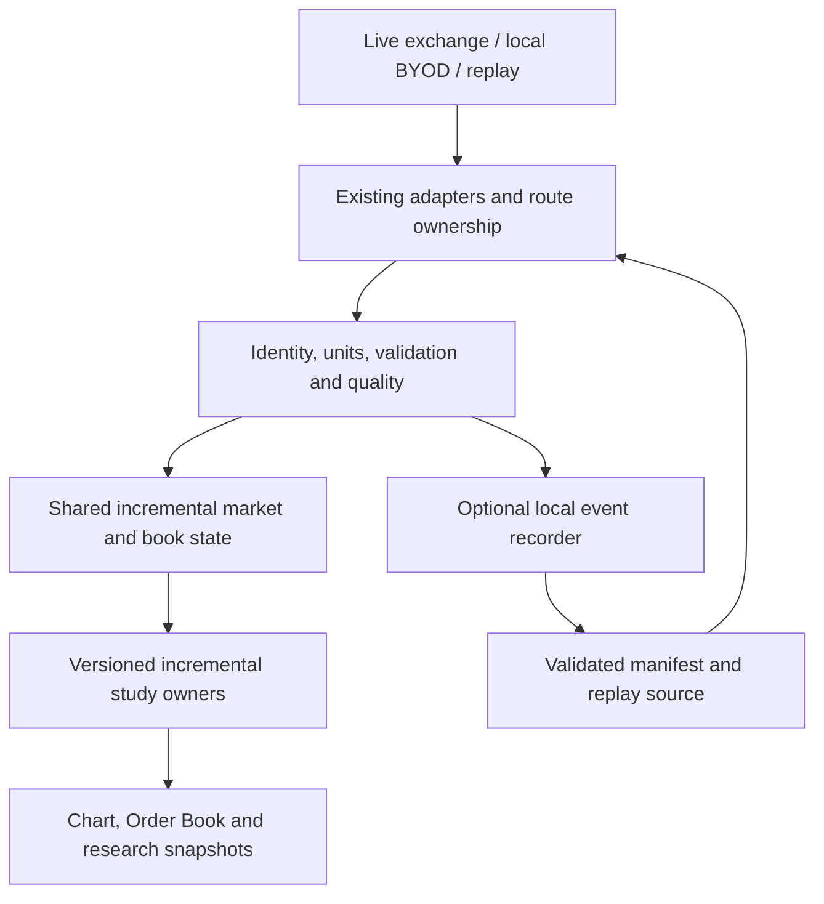

# Phase 11 — Verified Order Flow, Free-First Data and Universal BYOD

Revision: 2026-10-19, Asia/Baku. **Planning revision only. Phase 11 remains IN PROGRESS / IMPLEMENTATION PAUSED.** No milestone below is an instruction to resume implementation. Resume only after a subsequent human instruction identifies the authorized milestone. No application changes, package installation, account connection, deployment or live orders are authorized by this document.

Repository: `C:/Users/aykhank/Desktop/Others/Projects/ZT`.

Authoritative repair context:

- [Common execution contract](../COMMON-CONTRACT.md), [master execution prompt](../MASTER-EXECUTION-PROMPT.md), [original stage dependencies](../PLAN.md), [assertion ownership](../traceability.csv).
- [Immutable original audit](../../web-terminal-audit-2026-10-18-1334/AUDIT.md).
- [Phase 11 pause checkpoint](../../web-terminal-repair-2026-10-19-phase11/HANDOFF.md), adjacent ledgers, `before/`, patch and evidence. These retain the implementation history; do not overwrite them with this revision.

This file is the revised Phase 11 design authority. The generated `PROMPT-SET.md`, `stages.json`, generator and planning manifest still describe the original prompt; they were deliberately not regenerated during this single-file revision. Before future execution, reconcile their Phase 11 summaries with this file without rewriting immutable audit evidence. The original phase prerequisites remain 01, 02, 03 and 04, with their outstanding acceptance limitations visible. Expanded milestones are proposed scope, not retroactive authorization or automatic prerequisites for every existing repair stage.

## 1. Executive Summary

Build one trustworthy flow from observed market events to shared calculations, visual evidence and repeatable research. Preserve the current gateway, provider synchronizers, public-stream path, chart documents and paired Windows research Helper. Upgrade their contracts and ownership incrementally; do not add indicator-specific connections or a parallel data platform.

The first deliverable is a verified live Binance/Gate trade-and-L2 baseline. Trade-only analytics must survive independently healthy trades when depth fails. Depth and combined studies must withhold results when their own prerequisites fail. Current bounded views are useful observation tools, not full-session footprints, continuous historical heatmaps or proof of hidden orders.

The proposed path is 11A correctness, 11B BYOD with an early 11B0 recording/conformance slice, 11C visualization, 11D detectors, 11E polished replay/research and 11F optional MBO. Complete minimal original-event capture, manifest validation and deterministic headless playback in 11B0 before persistent heatmap or empirical detector acceptance. Controlled live-only C/D work may proceed with explicit limitations; historical validity requires accepted recordings. Reuse existing event-manifest contracts rather than introduce another format.

The competitive hypothesis is a coherent, accessible workflow: select an observation, inspect its evidence and quality, replay the same inputs, and test a declared hypothesis out of sample. It is not a claim of feature parity, faster rendering, institutional coverage or profitable signals. Demonstrate advantages with comparable data, tasks and measurements (§4, §18, §20).

## 2. Verified Current Implementation State

Inspection basis: working-tree source and saved local artifacts read on 2026-10-19. The checkout is extensively dirty, including staged and untracked work from prior phases and native workstation work. Preserve all of it. No product test suite or live/browser session was run for this planning revision. “Implemented” below means source exists; it does not certify runtime acceptance. “Partial” means a concrete subset exists. “Planned” means new scope. “Unsupported” means required source/capability is absent. “Unverified” means evidence is insufficient.

| Area | Current evidence and status | Boundary / next proof |
| --- | --- | --- |
| Gateway and UI subscriptions | Implemented: `mini-services/market-data/index.ts`, provider modules, `src/hooks/use-market-stream.ts`; shared Socket.IO and subscriber maps, selection generation guards | Hook output still uses a common `ready` gate; per-hook retained arrays are not one canonical study owner. Check direct-path and gateway parity, reconnect and late callbacks |
| Binance USD-M books | Implemented, acceptance Partial: `mini-services/market-data/binance-order-book.ts`, `src/lib/market/public-stream/binance-depth.ts`; snapshot boundary and subsequent `pu` linkage fixes | Preserve boundary behavior; dedicated fixtures exist in `tests/binance-book-integrity.test.ts` and `tests/l2-orderbook-reconstruction.test.ts`. Direct fallback endpoint/browser operation remains Unverified |
| Gate futures book | Implemented, acceptance Partial: `mini-services/market-data/order-book.ts`, `gateio-provider.ts`; buffered REST bridge, deletion, gap reset, `full` replacement branch | Provider currently subscribes to `futures.order_book_update`, with depth 100 also used for REST; newer `obu` is a separate protocol. Atomic malformed/crossed/reset behavior needs independent proof; do not assume Binance tests cover Gate |
| Quantities and Big Trades | Implemented, acceptance Partial: `src/lib/market/trade-units.ts`, `src/lib/chart/overlays/big-trades.ts`, provider normalization; base/contracts, linear multiplier, raw/aggregate distinctions | Unknown notional remains unavailable; inverse contracts unsupported by this conversion. Existing calculation identities: order flow `p0.1.1`, Big Trades `1.1.0` |
| Pure studies | Implemented: `src/lib/market/order-flow.ts`: delta, CVD, footprint, imbalance, microprice, tape, trade-pattern candidates, OI change, CVD divergence and diagonal imbalance functions | Exported function is not proof of active UI exposure, canonical lifecycle, correct sessions or full retained history |
| Current Order Book context | Partial: `src/components/terminal/docking/orderbook-panel.tsx`, `order-flow-context.tsx`, `src/lib/market/order-flow-context.ts` | Nine selectable layers: rolling CVD, delta, footprint, trade profile, imbalance, microprice, observed snapshot heatmap, absorption/sweep candidates. Calculations run inside `ObservedFlow`; sampled depth history is component-owned |
| Retention / controls | Implemented bounded context: 2,000 prints, 120 depth frames, nearest 20 levels/side; sanitized settings persist in canonical chart-document overlays | Default context window 60s, 1s buckets, one-tick grouping, top five levels; quantity minimum 5, dominance .8, sweep 3 prices, absorption range 2 ticks. These are observation defaults, not calibrated signals. Lifecycle/browser behavior remains Unverified |
| Quality and stale clearing | Partial: quality-loss clearing in hook, Big Trades gating, freshness checks; `tests/stream-quality.test.ts` | Shared health can withhold valid trade studies after a book fault. `TradeEvent.side` currently has no unknown state; source classification and separate quality need migration |
| Other exchanges | Partial code and fixtures: `src/lib/market/{bybit,okx,coinbase}.ts`, public-stream/provider paths; tests include OKX checksum and Coinbase reconstruction | No current-turn live validation. Kraken absent from current `ProviderId`, `Exchange` and `MarketProvider` types. Spot also absent from `ContractMetadata.product`; catalog names are not capability proof |
| Recording contracts | Implemented types: `src/lib/local-research/contracts.ts`: `InstrumentUnitsV1`, `IngressProvenanceV1`, `FeedQualityEpochV1`, `EventDatasetManifestV2`, `EventRunRequestV2` | Already defines nanosecond strings, available-time ordering, fragment hashes and zstd declaration. No accepted complete event recorder/replay journey established by this inspection |
| Python / Helper | Existing candle research path: `research-workbench.tsx`, `src/lib/local-research/{client,contracts}.ts`, `research/desktop/{server,engine,validation}.py` | Protocol 1 and loopback port 47321; exact origins, Host checks and pairing exist; browser bearer is memory-only. Broker bridge, OS credential vault and event-study execution remain Planned / Unverified, not implied by types |
| MBO | Contract only in `src/lib/market/types.ts`; production provider access Unsupported / Unverified | An `MBOEvent` interface and Rithmic stub are not a real feed, queue engine or entitlement |
| Native workstation | Separate existing Windows/Rust work remains outside this browser-terminal revision | Do not replace native Win32/Direct3D/WinUI with browser embedding, Tauri or an external chart/backtest engine |

Saved evidence, independently checked for existence/content during this revision:

- `artifacts/web-terminal-repair-2026-10-19-phase11/evidence/context-views.log`: saved run reports **20 passing tests**. `context-typecheck-latest.log` records `tsc --noEmit` with no printed diagnostics. These are prior-run artifacts, not fresh executions.
- `HANDOFF.md` records an earlier **317-test** pass, bounded local Gate/Binance gateway captures and 100-trade independent ledgers per venue. It explicitly says the 317-test result predates later context/quality edits. Do not call it full-suite acceptance of the paused checkout.
- `coverage.json` records 252 original observations plus 17 execution assertions, Phase 11 IN PROGRESS, browser BLOCKED, deployed false. Ledgers/patch/preservation records lag the final context additions according to the handoff; reconcile before closing anything.
- Browser control, settings restoration, rapid switching, assembled candidate and deployed acceptance of the new context remain **NOT TESTED / previously BLOCKED**. Connection availability must be reassessed only when execution is authorized; this revision does not diagnose or bypass that blocker.

Current trade-pattern absorption/sweep candidates use trade dominance, total size, price range and distinct price bins. They do not consume synchronized depth. Preserve their honest estimate labels; do not recast them as confirmed resting-liquidity absorption or chronological multi-level sweep reconstruction.

Source-review flags for the first resumed milestone: `detectCVDDivergences` currently falls back to index alignment when timestamps do not match; review causal bucket alignment and add missing-bucket/future-tail regressions before exposure. `calculateDiagonalImbalances` compares adjacent stored rows rather than checking exact adjacent tick groups and uses a finite999 sentinel for zero opposition. New diagonal/stacked output must distinguish absent coverage from proven zero, enforce actual tick adjacency and expose one-sided cells explicitly. These are source-inspected risks, not newly reproduced runtime defects; this revision changes no calculation code.

## 3. Business and Product Objectives

1. Useful no-paid-feed baseline: live public crypto tape, Big Trades, observed footprints, delta/CVD, profiles, verified DOM and explicit quality. Software cost and public API availability are different from redistribution rights.
2. User choice: public providers, eligible personal broker/vendor connections, local recordings and custom local adapters; no mandatory AMP/CQG/Rithmic partnership.
3. Evidence before interpretation: show observations, formulas, thresholds, invalidating conditions and coverage. Avoid actor identity, manipulation, intent and probability claims without evidence.
4. Reproducibility: same accepted data, versions and configuration produce the same outputs; reconnects and missing intervals remain visible.
5. Modest operating footprint: direct connections when supported, existing gateway otherwise, local storage/Helper by default. Networking, storage, deployment, support and license administration have real costs; quantify them.

Measure task completion, correctness, time/interactions, p95/p99 latency, memory, accessibility and total user cost. A mathematically correct detector may have no predictive value.

## 4. Competitive Benchmark: ATAS vs DeepCharts vs ZTerminal

Research scope: official public documentation accessed 2026-10-19; product builds, subscriptions, matching datasets and runtime internals were not inspected. Deepchart and DeepDOM are distinct offerings; a DeepDOM feature is not automatically included in every Deepchart package. Official claims are documentation evidence, not independently verified performance or signal accuracy. Source identifiers below resolve to direct official links in §24.

Every row specifies current state, proposal, required data/dependencies, acceptance, priority and a possible advantage. **All advantage statements are hypotheses; none establishes superiority.** D means valid trades with explicit classification; B means verified MBP; A means aligned D+B; O means genuine order-level data. “Same task” comparisons require legally usable equivalent inputs and settings; otherwise report incomparability.

| # / capability | ATAS documented | DeepCharts documented | ZTerminal current → proposal | Data / dependencies | Testable acceptance / possible advantage | Priority / source |
| --- | --- | --- | --- | --- | --- | --- |
| 1 Footprint / clusters | Footprints | Footprint listed | Partial tables → chart-native tick cells | D, metadata, chart transform | Independent cell totals; pan/zoom alignment. Hypothesis: shared research selection | 11A/C; A1, D2 |
| 2 Bid/ask, delta, CVD | Delta/CVD | CVD, delta bar | Partial rolling sums → explicit session/anchor/rolling modes | D, shared study owner | Hand sums; book-only failure preserves trade output. Hypothesis: clearer coverage | 11A; A1, D1 |
| 3 Big Trades / tape | Smart Tape / Big Trades | Big Trades | Partial overlay/tape functions → consistent filtering and grouping | D, units, granularity | Quote thresholds and grouping conserve size; no aggregate-as-fill. Hypothesis: traceable grouping | 11A/C; A1, D1 |
| 4 Volume/delta profiles | Profiles | Volume/delta profile | Partial observed profile → POC/value area and delta profile | D, session rules | Histogram conservation and deterministic ties. Hypothesis: reproducible region studies | 11C; A1, D2 |
| 5 DOM / ladder | Smart DOM columns | Advanced DOM | Partial basic table → configurable analytical columns | B, metadata | Sorted ladder, correct deletion and cumulative units. Hypothesis: visible reasons per column | 11A/C; A2, D2 |
| 6 Heatmaps | Heatmap | DeepDOM heatmap | Partial snapshot SVG → tiled observation-aware heatmap | B; recorder for historical coverage | No filled gaps; sampling legend. Hypothesis: auditable unavailable regions | 11C/E; A4, D3 |
| 7 Stacking / pulling | Depth-change modes | Book tools; exact stacking definition Unverified | Planned net changes | B contiguous updates | Separate additions/reductions from executions; no cancellation certainty. Hypothesis: explicit ambiguity | 11C; A2, D1 |
| 8 Absorption / exhaustion | Absorption-related tools | Absorption | Partial trade-pattern candidates → aligned detectors | A for absorption; D exhaustion | Evidence/negative fixtures, no actor claims. Hypothesis: inspectable trigger and invalidation | 11D; A1, D4 |
| 9 Stops / sweeps | MBO tools | Stop Run | Partial distinct-price candidate → directional sequence evidence | D/A candidate; O/vendor flags for stronger attribution | No inferred stop order becomes observed fact. Hypothesis: evidence tiers | 11D/F; A3, D5 |
| 10 Icebergs | MBO indicators | Cumulative Iceberg/Stop | Unsupported real feed → conditional candidate | O, provider-specific lifecycle | Hidden total unavailable; require permitted feed. Hypothesis: clear observation limits | 11F; A3, D6 |
| 11 MBO / queues | MBO DOM | MBO source option | Contract only → visible-order lifecycle | O and priority rules | Rebuild visible queue; unknown own position stays unknown. No current advantage established | 11F; A3, D3 |
| 12 Replay | Multiple real/generated modes | Deep Replay listed | Planned accepted event replay; candle replay separate | Manifest/checkpoint, same engines | Seek equals prefix; preserve gaps. Hypothesis: one cursor and input hashes | 11E; A5, D2 |
| 13 Custom studies / automation | Indicator/strategy API | Pattern Builder listed; general code API Unverified | Partial Python research → event study API | Existing Helper, resource isolation | Declared inputs and versioned outputs; no live execution. Hypothesis: transparent event access | 11E; A6, D2 |
| 14 Backtesting | Replay simulation; equivalent statistical engine Unverified | Auto-Backtester listed | Partial candle research → cost-aware event research | 11E, execution assumptions | Past-only decisions, costs and holdout; no alpha promise. Hypothesis: reproducible reports | 11E; A5, D2 |
| 15 Cross-venue | Multi-instrument replay; merged venue analytics Unverified | Multi-feed support; merged analytics Unverified | Planned explicit comparative views | Multiple valid identities, clock uncertainty | Independent venue totals; no synthetic merged queue. Hypothesis: comparable provenance | Later C/E; A5, D7 |
| 16 Visualization performance | Analytical UI documented; benchmark Unverified | Heatmap UI documented; benchmark Unverified | Unverified → measured viewport rendering | §18 workload, hardware | Repeated frame/latency measurements on equivalent task. No current advantage established | 11C; A2, D3 |
| 17 Provider flexibility | Connections offered | Several feeds listed | Partial exchange code → provider capabilities + local BYOD | Adapter/rights/Helper | Conformance tests and exact unsupported reasons. Hypothesis: useful public baseline | 11B; A1, D7 |
| 18 Explainability | MBO detail cards/evidence timeline and local history documented | Indicator guides/settings | Partial candidate metrics -> evidence inspector | Event references, algorithm versions | Trace every trigger to accepted observations; uniqueness unproven. Hypothesis: portable same-input research workflow | 11D; A3, D4 |
| 19 Reproducibility | Replay documented; output hashes Unverified | Replay/backtester listed; hashes Unverified | Contract foundation → frozen research bundle | Versions, manifest, seeds | Repeated canonical output hashes. Hypothesis: exportable research provenance | 11E; A5, D2 |
| 20 Cost / access | Free/delayed and paid tiers described | Paid bundles | Planned free-first crypto baseline; paid feeds optional | Rights, jurisdiction, infrastructure | Publish itemized software/data/storage costs. Hypothesis: lower entry cost for eligible crypto users | 11A/B; A1, D2 |

ATAS explicitly offers generated-tick/generated-DOM modes as well as real ticks+DOM; therefore do not describe every competitor replay as actual historical liquidity. [ATAS replay](https://atas.net/modules/market-replay/). DeepDOM documents MBP/MBO source selection and feed-dependent availability; do not assume every subscriber has MBO. [DeepDOM heatmap](https://www.deepcharts.com/helpcenter/deepdom/article/heatmap).

Validation protocol: choose three tasks—configure a footprint, explain one detector event, reproduce a replay result. Record version/tier, dataset/granularity, settings, hardware, accuracy, time, clicks and inaccessible steps. Compare medians over five runs; publish errors and coverage limits, not an overall “better” score. Marketing claims about institutional intent or future price response are not accepted as evidence.

## 5. Market-Data Availability and Licensing Reality

Protocol availability is distinct from eligibility, local analysis, recording, non-display use and redistribution. All rights must be scoped to the exact provider product, jurisdiction, account and application. The following is a technical intake matrix, not a license grant. Current terms and throttles must be checked again at adapter implementation and release.

| Source / priority | Verified technical starting point | Auth / granularity / depth / throttling | Rights and remaining gate |
| --- | --- | --- | --- |
| Binance USD-M / 11A | Public market streams and REST depth; `pu`-linked reconstruction [B1] | Public market-data path; MBP; guide snapshot up to 1,000 levels; raw/aggregate stream identity must be preserved. Current guide uses `/public/stream`; exact stream/control limits must be pinned for this product, not copied from Spot | Local deployment/jurisdiction, recording and redistribution terms UNVERIFIED; historical L2 coverage not established |
| Binance Spot / 11B | Trades/aggTrade and diff-depth [B2, B3] | No private account permission for public stream. Separate spot bridge; published connection/control limits in B3: 24h connection lifetime, 5 incoming control messages/s, 1,024 streams, 300 connection attempts/5min/IP | Spot implementation is Planned, not enabled by perpetual catalog mapping. Rights/jurisdiction UNVERIFIED |
| Gate futures / 11A | Existing legacy book channel; distinct newer `futures.obu` [G1] | Public trades/MBP; legacy update depth must match REST; channel-specific frequency/depth. Decimal-size transport matters. General connection/REST quotas must be captured before release | Linear metadata and settlement required. Exact local-analysis/recording/redistribution rights and regional eligibility UNVERIFIED |
| Gate Spot / 11B | Official Spot WS reference, `spot.trades`, `spot.order_book_update` [G2] | Public/private separation documented; MBP, not MBO. Old reference is accessible but newer starting URL failed extraction; latest channel depths/rates require revalidation | Planned; do not transplant futures contract conversion. Latest terms/quotas UNVERIFIED |
| Bybit Spot / linear perpetuals / 11B | `publicTrade`, `orderbook.{depth}.{symbol}` [Y1, Y2] | Public channels, snapshot/delta; current depth options 1/50/200/1,000, published frequencies 10/20/100/200ms; new snapshot resets. Connection attempts limited; 20s ping recommendation | Existing code Partial; instrument-specific support, regional endpoint, terms/recording/redistribution UNVERIFIED |
| Kraken Spot / 11B | Public `trade` and `book`, checksum model [K1] | MBP; selected depth and ordered update/checksum handling. Exact current trade limits, connection quotas and precision guide must be pinned at intake | New provider type/catalog support required. Usage/recording/redistribution terms UNVERIFIED |
| Coinbase public / 11B | Advanced Trade `market_trades`, `level2`, heartbeats [C1] | Public endpoint currently documents no JWT requirement; trades arrive in batches, L2 snapshot/updates. Confirm per-trade side convention, depth scope and rate page before enablement | Existing code Partial. Product aliases can map USDC subscriptions to USD data; reject silent identity substitution. Rights/quotas/eligibility UNVERIFIED |
| OKX standard / 11B | Public standard book channels; official JSON checksum deprecation [O1, O3] | Standard books/100ms and gated faster TBT are distinct; regional VIP thresholds differ. JSON checksum now constant zero; use current sequence/reset semantics, not legacy CRC | Review existing numeric-checksum validation before admission. Exact region/depth/rates/endpoint migration and rights remain release gates; no VIP entitlement assumed |
| Kraken L3 / 11F | Authenticated order-level channel [K2] | Token required; 200 symbols/connection, depth 10/100/1,000, depth-weighted subscription rate counts; one depth per symbol. Excludes hidden iceberg quantity and untriggered stops | Eligibility/token scopes, terms, local recording and application access UNVERIFIED; optional proof of concept |
| IBKR TWS/Gateway / optional 11B pilot | `reqMktDepth`, positional insert/update/delete, reset error 317 [I1, I2] | User account/TWS or Gateway and appropriate subscriptions; depth is not complete individual-order identity. Dynamic request limits and API entitlements must be queried | User-funded; subscription does not automatically permit third-party access or recording. Exact account/application/usage rights UNVERIFIED |
| Databento / optional 11E/F | Documented trades, MBP and MBO schemas; historical/live APIs [DB1] | User API key, dataset/schema-specific entitlement; paid usage/subscription may apply. Rate and delivery contracts require pilot-specific review | Recording/non-display/export rights depend on agreement and exchange; UNVERIFIED for ZTerminal |
| Rithmic / CQG / AMP / deferred | Rithmic official API entry point [R1] had no readable specification; current repo has interface stubs | Developer/application access, conformance, provider credentials and exchange fees unresolved; AMP is a broker route, not universal feed authorization | Commercially restricted; no automatic self-service integration or partnership claim. All ZTerminal access/recording/distribution permissions UNVERIFIED |
| CME ES/NQ / optional | CME policies distinguish usage and licensing categories [CM1] | Require legitimate licensed source, exact contracts/expiry/calendar, subscriber and non-display eligibility | Paid/conditional access stays optional; no redistribution of one user's feed to other users |

Unknown rate limits block enabling a new production adapter, not drafting its design. At intake record official URL, retrieval date, REST weight/limits, connection/subscription caps, heartbeat, retry policy, depth boundary, terms revision, supported regions and test evidence. Honor 429/Retry-After and entitlement errors; jitter/backoff must not become rate-limit circumvention.

## 6. Free-First and BYOD Strategy

**A: Public crypto.** Finish Binance/Gate perpetuals first; add Spot as distinct instruments, then Bybit, Kraken Spot, Coinbase and standard OKX based on verified access and correctness. A provider code path is not admission to the supported list. Use direct public WebSockets where browser/protocol/terms permit; otherwise existing gateway or local Helper. Exactly one source route owns each instrument generation; direct fallback and gateway must never double-count overlapping events.

**B: User-authorized vendors/brokers.** Offer adapter slots and a documented pilot process. IBKR and Databento are candidates, not committed production integrations. If credentials confer insufficient API rights, show entitlement failure and preserve unrelated public connections.

**C: Custom local adapters.** User runs a local process that sends versioned validated events over an explicitly paired Helper channel. This is a data boundary, not plugin code executed in the browser. Limit message sizes/rates, instrument capabilities and ownership. Disable unsupported versions and isolate crashes.

**D: Imported recordings.** Accept canonical manifests first; CSV/JSON trades next. Columnar input is optional only after measured need and library review. Never guess side, unit, timezone or missing sequence. Trade-only files enable trade-only studies; depth files need initial state plus valid deltas/reset semantics. Exchange-time-only imports cannot support receive-time-realistic strategy claims.

**E: Restricted commercial feeds.** Maintain a provider feasibility record; no dependency on commercial partnership for baseline usefulness. Software licensing, feed access, application approval, display/non-display rights and redistribution are separate checks.

Cost model: default local recording, user quotas and no mandatory cloud storage. Optional shared public gateway service requires explicit distribution-rights and operating-cost review. Commercial connections remain user-isolated local routes by default; never route them through the shared public broadcaster.

## 7. Shared Market-Data Architecture

Logical layers below describe responsibilities, not required new services/packages:



The recorder taps accepted events before UI sampling. Recorder failure degrades historical coverage independently of healthy live feeds. This graph shows responsibility flow, not separate services.

### Ownership and isolation

Extend existing subscriber maps and source routes. Preserve pure functions as reference definitions; introduce a minimal shared state owner alongside `src/lib/market/order-flow.ts` when 11A is authorized. Do not build a generic plugin bus, microservice cluster or second exchange manager.

- Raw market owner key: provider + venue + environment + full instrument ID + connection/account entitlement scope + generation + live/recording session. Never share commercial state across users. Public raw state may be shared within an authorized client, but workspace visibility remains scoped.
- Study owner key: raw key + algorithm version + canonical configuration hash + session/reset anchor + classification/alignment policy. Workspace/chart-document IDs scope subscriptions and settings; identical allowed configurations can share computations. Independent settings must not mutate another chart's study.
- First subscriber starts an owner; additional subscribers receive the same snapshot revision. Last subscriber releases timers/listeners/state. An explicitly active recorder is its own subscriber; it cannot accidentally keep invisible UI subscriptions alive.
- On generation change: unsubscribe old route, reject late callbacks, journal boundary, invalidate old book and reset study state under a new generation. A continuous trade session across reconnect requires proven deduplication and complete recovery; default to a visible discontinuity.
- `apply(event)` performs incremental updates; `snapshot()` publishes immutable outputs at display cadence; `reset(reason)` and versioned checkpoint restore are deterministic. Pure batch reference and incremental output must agree.
- UI controls persist only configuration in existing chart-document overlays. Observations never enter workspace snapshots or localStorage as historical truth.

Begin with TypeScript and installed dependencies. Move computation to a worker if ingestion/frame measurements exceed §18 budgets; require the same schema and golden fixtures. Native/Rust/WASM acceleration is conditional on profiling, build support and parity tests, not a prerequisite for simple delta. Python consumes shared versioned study outputs or the same engine through the local bridge; do not maintain independently drifting formula implementations.

## 8. Normalized Event and Instrument Contracts

Reuse `src/lib/market/types.ts`, `provider.ts` and **existing** research event contracts in `src/lib/local-research/contracts.ts`. The following are planned amendments, not claims that current producers populate them.

| Contract | Required content and migration |
| --- | --- |
| Instrument | Stable provider/venue/product/native symbol; base/quote, linear/inverse/quanto contract model, expiry, settlement, tick/lot, multiplier and its dimension; metadata revision, valid interval and observed-at time. Extend product to Spot and currencies/provider enums deliberately; no canonical-symbol-only identity |
| Envelope | Existing ingress provenance: stream ID, subscription generation, ingress ordinal, received UTC ns, monotonic receive ns, available-at ns, adapter version, native ID and sequence fields, batch index. Add exchange timestamp + precision/source, source route, metadata reference and raw-message digest when retained |
| Trade | Price/quantity as lossless decimal or checked scaled integers; native size unit, optional derived base/quote with conversion method; aggressor buy/sell/unknown, classification method venue/inferred/unknown; individual/aggregate/unknown, trade ID/range. Preserve aggregation provenance through all outputs |
| Depth | Explicit snapshot/delta kind, replacement scope, absolute-vs-relative quantities, advertised/observed depth, U/u/pu or provider equivalent, checksum and lexical decimals where required. Current `DepthEvent.levels` is a materialized view, not a lossless delta recording |
| MBO | Order ID scoped by source/generation; action vocabulary mapped from venue semantics, price/size/side, priority evidence where supplied. Removal is not automatically execution; missing priority means unknown queue order |
| Quality | Extend `FeedQualityEpochV1` per trades/MBP/MBO/metadata/alignment/recording. Preserve observed/effective times; integrity and freshness remain independent, with structured reason, counts and affected ranges |
| Manifest | Extend `EventDatasetManifestV2` compatibly or bump version: metadata/protocol/engine versions, provenance, rights reference, initial snapshots, quality/gaps, fragments/checkpoints and hashes. Existing declared zstd fragments remain the canonical target; no new competing format |
| Study output | Identity/generation/config/version, revision, `asOfAvailableAt`, event-time range, value or unavailable reason, required streams, coverage/gaps, units/granularity and evidence references. Null/unavailable is distinct from valid numeric zero |

Identifiers and epoch nanoseconds must remain strings/BigInt at boundaries, not lossy JavaScript numbers. Integer tick/lot conversion requires verified precision and safe range; reject overflow or off-grid values rather than round silently. Preserve current calculation behavior under its version; a binning/reset change increments algorithm version and updates golden results.

For linear contracts, base quantity = contracts × base-per-contract; quote notional = price × base quantity. Spot base quantity already has base units. Inverse/quanto require their own instrument formula and settlement unit; do not apply current `tradeNotional()` linear rule. USDT quote value is not silently USD. Cross-venue sums require explicit conversion, clock policy and provenance.

Deduplication key: full source identity + generation scope + native event identity/batch item. Reconnect recovery may compare stable native IDs across generations within the same source, with bounded retention. Same timestamp/price/size is not a safe duplicate key. Conflicting same-ID payload is INVALID, not “last wins,” unless protocol explicitly defines replacement.

## 9. Quality, Synchronization and Book Reconstruction

### Independent quality

Each stream uses `CONNECTING → SYNCHRONIZING → READY`, with explicit `STALE`, `GAP_DETECTED`, `INVALID`, `UNAVAILABLE`, `RECOVERING`. Map existing enums at compatibility boundaries; do not add a parallel contradictory status system. Record state/reason, last accepted receive time, source time/precision, sequence, generation and coverage. Provider heartbeat proves transport only; sparse markets require documented liveness policy, not invented activity.

| Dependency | Allowed when another input fails | Withholding rule |
| --- | --- | --- |
| D: trades + required metadata | Trade delta, CVD, Big Trades, trade footprints/profile can continue after MBP gap | Trade gap/unknown side/unknown necessary conversion yields partial or unavailable by field; no fake zero. Unclassified volume stays explicit |
| B: MBP + metadata | DOM/imbalance/microprice can remain valid during trade outage | No fresh verified two-sided book means no live metrics. A saved last observation may appear only as dated stale evidence |
| A: trades + MBP + alignment | None of the combined detectors may claim full readiness with one missing input | Gap, excessive age/skew or uncertain alignment disables combined result; trade-pattern-only candidates keep their separate name |
| O: MBO + metadata/priority | MBP studies may still work if independently valid | MBO fault disables order-level studies and own-queue claims |
| Recording | Live analytics may continue after disk/recorder failure | Historical coverage stops/marks gap immediately; never label session complete |

Proposed initial liveness policy: transport and trade-stream integrity use documented heartbeats, subscription acknowledgement and sequence/coverage evidence; ten seconds without executions is an activity warning, not sufficient evidence that a healthy quiet trade stream failed. Without a venue-supported continuity/liveness proof, disclose uncertainty. MBP target age is three seconds since a valid update or protocol-confirmed unchanged state; combined causal-book age <=250ms and clock uncertainty <=100ms are initial configurable, versioned targets. Validate against channel cadence and quiet-market fixtures. Current 15s context depth-age checks do not certify this policy. No heartbeat certifies complete upstream trade coverage by itself.

### Ordering and cross-stream alignment

1. Ingress assigns monotonically increasing ordinals before queueing, with monotonic receive time and UTC observation. Per-venue sequence rules determine book order, never a global timestamp sort.
2. Preserve existing manifest canonical order `available_at_ns,ingress_ordinal,stream_id,batch_index`. It represents when data became knowable, not matching-engine causality. Adapter receive batches need deterministic item order. Imported exchange-only data declares weaker timing.
3. Combined study associates a trade only with a valid book already available at the decision point. Reject event-time relationships outside declared skew/precision bounds. Never use a later-arriving snapshot to imply earlier knowledge.
4. Default live reorder delay is zero. An optional bounded event-time alignment window (proposed maximum 100ms) may wait for late messages only if the output's available-at is delayed accordingly. Persist watermark/buffer state; events beyond watermark become late/uncertain, never silently rewrite emitted research decisions.
5. Across hosts/venues monotonic clocks are incomparable; retain per-process clock epoch and offset uncertainty. Display network/source age separately; event-minus-wall time alone is not a one-way latency measurement.

### Venue-specific book rules

| Adapter | Required protocol behavior | Dedicated fixtures |
| --- | --- | --- |
| Binance USD-M [B1] | Buffer before REST; first event includes snapshot ID (`U <= id <= u`), subsequent `pu == previous u`; absolute size, zero deletion; current public WS route verified at execution | Event ending exactly at id, valid U jump with linked pu, gap, old snapshot, duplicate, malformed/crossed atomic reset |
| Binance Spot [B2/B3] | Separate snapshot/diff bridge around snapshot+1 and Spot update-range rules; do not reuse futures pu rule | Spot-specific range boundaries, snapshot depth truncation, reconnect |
| Gate legacy [G1] | Bridge snapshot+1, process covered U/u ranges, gap resnapshot, same REST/subscribed depth, empty updates still advance ID/time | Depth mismatch, overlap/duplicate/gap, empty sides, stale REST generation, decimal sizes |
| Gate `futures.obu` [G1] | Initial/repeated `full=true` replaces book; incremental continuity is its documented rule, not legacy generic merge | Repeated full reset, missing U on full, strict next-range rule, resubscribe; never feed this schema directly into a legacy U-required buffer |
| Bybit [Y1] | New snapshot replaces state; zero deletion; `u=1` service restart reset, level-one repeats may keep same u | Repeated snapshot, restart, no-change heartbeat distinction, no fabricated +1 seq requirement |
| Kraken MBP [K1] | Ordered updates, requested-depth truncation and documented checksum on exact decimal representation | Checksum/precision, multiple same-price updates, deletion, truncation and recover |
| Coinbase [C1] | Channel-specific snapshots/updates, quantity replacement and sequence scope; confirm maker-side semantics before aggressor mapping | Channel-specific sequence gap, batch items, side inversion fixture, alias mismatch |
| OKX [O1, O3] | Pin current standard-channel seqId/prevSeqId, snapshot/reset/no-change rules. Official JSON checksum deprecation took effect in production on 2026-06-23: present checksum=0 is not integrity verification. Existing CRC tests apply only to their historical protocol version | Current zero-checksum, reset/no-change/gap and entitlement fixtures; legacy CRC only where actually supported |

All books validate whole message before publication. Mutation failure clears readiness atomically; malformed late snapshot cannot replace a new generation. Empty/one-sided/crossed/negative/off-grid books withhold relevant metrics. A level outside subscribed depth is unknown, not zero. Do not silently cap bootstrap deltas and then claim continuity: overflow must force resynchronization and a quality transition.

## 10. Universal Provider-Adapter System

Extend the existing `MarketDataProvider` and gateway lifecycle rather than replace them. Keep wire normalization distinct from deterministic market-state processing. Introduce capability methods only as milestones need them; the semantic contract is stable even if transport differs.

```text
Adapter v1:
  descriptor -> provider/version, supported transports, auth modes
  capabilities(instrument, entitlement) -> trades/MBP/MBO, depth, cadence,
    granularity, sequence/checksum model, live/delay, history, restrictions
  discover(query, cursor) -> bounded verified instrument metadata
  connect(localCredentialHandle?) -> connection generation
  subscribe(instrumentId, requested streams/depth) -> handle + accepted capabilities
  events(handle) -> normalized envelopes + quality/limit/entitlement transitions
  unsubscribe(handle); disconnect() -> idempotent cleanup
```

Historical coverage returns exact intervals/data types/quality, not a Boolean. Authentication descriptor distinguishes public, read-only token, broker login and approved application; client sees only local opaque handles. Errors include AUTH_REQUIRED, ENTITLEMENT_DENIED, REGION_UNAVAILABLE, RATE_LIMITED, UNSUPPORTED_DEPTH, SCHEMA_UNSUPPORTED and TRANSPORT_UNAVAILABLE. Capability changes invalidate affected study dependencies immediately.

Conformance requires sequence rules, classification, quantity conversion, overflow/backpressure, reconnect generation and teardown fixtures plus a bounded live read-only trace when eligible. A custom adapter's claimed MBO capability remains unverified until schema/semantic validation; user input cannot toggle genuine L3 into existence.

## 11. Full Indicator Capability Matrix

### Specification rules applying to every row

Each row is a normative study family, not permission to expose every indicator at once. Before implementation, record algorithm version, inputs, parameter schema/defaults, session/window/reset, missing-data policy, incremental state, output location, evidence inspector, numeric fixtures and resource cap. Defaults below are proposed methodologies, not optimized trading parameters.

- D studies use accepted execution prices; classified buy/sell size B/S; unknown size U is kept separately. Bid/ask volume means aggressor-classified executions at the venue, not displayed resting size. Aggregate-message counts are message counts; execution counts unknown unless supplied.
- Default new footprint/profile session is UTC day, crypto only; event buckets are half-open intervals. Rolling default is trailing 60s; warmup and retained coverage are visible. Session/anchor aggregates require events from the start or a valid checkpoint. A gap splits the epoch; default no continuation as complete session. Existing bounded rolling behavior stays explicitly labeled until migrated/versioned.
- A time bucket with proven zero events may equal zero; an unobserved bucket is unavailable. Data late beyond declared watermark is flagged, and revisions never alter a previously knowable strategy decision.
- On reconnect/reset/metadata change, use §7/9 rules; configuration changes obtain a separate owner or deterministic rebuild. All visuals expose quantity units, granularity, coverage, parameters and algorithm version.
- Incremental entries update once; publish at ≤20Hz by default while renderer may draw at display rate. Caps use §18; eviction invalidates a study requiring evicted data unless sufficient aggregates/checkpoints remain.

### Tier 1 — executions

| Study / analytical purpose | Reproducible definition and proposed parameters | Incremental state / window / UI | Status / acceptance / priority |
| --- | --- | --- | --- |
| Bid/ask, delta, total footprint; clusters | Per time bucket and integer tick group: B, S, U, total=B+S+U, delta=B−S. One tick/group; 1m new chart bars, preserve current 1s context setting | Sparse price cells per bar, update touched cell; current table then chart primitive | Partial; total conservation and off-grid checks; 11A/C |
| Diagonal / stacked imbalance | At p, buy ratio B(p)/S(p−tick); inverse sell comparison. Ratio ≥3, numerator ≥user native minimum, ≥3 consecutive adjacent groups for stack. Denominator 0 => explicit zero-opposition marker, no infinite ratio | Update affected neighboring cells; finalize closed bars; chart highlights | Diagonal pure function exists, UI Unverified; asymmetric/zero fixtures; 11C |
| Bar delta / CVD | Delta=sum signed classified quantity; CVD cumulative since declared session/anchor; rolling CVD recomputes trailing sum via queue subtraction, not pseudo-session continuity | Scalar/session or bounded expiry queue; subpane/Order Book | Partial rolling; [2 buy,1 sell,3 buy] => delta/CVD 4, prefix [2,1,4]; 11A |
| Session / anchored / rolling CVD modes | UTC midnight or explicit validated anchor; rolling 60s. Missing start => partial since observed start; no seed implied | Session running state; rolling removes expired contributions; cursor anchor persists setting only | Planned complete semantics; session boundary, evictions and reconnect fixtures; 11A/C |
| Big Trades bubbles | Filter by native or verified quote notional; group only same venue/side/unit/granularity within user aggregation window and price policy; never label cluster a single order | Bounded group accumulator; chart primitive and tooltip; retain existing saved thresholds/windows | Partial; current tests preserve quote/native conservation, window/threshold controls; 11A |
| Smart Tape | Sorted visible events/groups, filters for side/unit/size, source event references. Default grouping off; no invented participant identity | Append/group in bounded ring; virtualized tape; display receive/event order choice | Pure tape exists, richer UI Planned; row ledger and aggregate labels; 11C |
| Speed / intensity / trades per second | Accepted message count / covered seconds, separately size/time; true execution rate only with execution count. 1s buckets, rolling 10s | Ring of counters; tape/mini histogram; no interpolation through gaps | Planned; count vs aggregate fixture and quiet/gap intervals; 11C |
| Trade-size distribution | Native-unit histogram with fixed explicit bin edges; p50/p90 calculated exactly within retained window, not undefined cross-unit mixture | Count bins plus bounded values if exact quantiles requested; context panel | Planned; boundaries and quantiles from fixed ledger; 11C |
| Volume / bid-ask / delta profile | Sum per price over selected complete coverage. POC highest total, ties choose lowest tick; value area 70%: expand from POC by larger adjacent volume, ties lower price first | Sparse profile; VAH/VAL on demand after changes; chart side primitive | Partial total/bid-ask observed profile, VA Planned; independent conservation and tie fixture; 11C |
| Session VWAP / envelopes | sum(price×base-equivalent size)/sum(size), weighted variance; ±1/2 standard deviations. Native linear contracts allowed with constant multiplier; inverse requires explicit weighting definition | Sum w, wp, wp², stable variance implementation; session reset; chart | Order-flow trade spec Planned; bar VWAP elsewhere is not proof; [100×2,102×1] => 100.666…; 11C |
| Delta/CVD divergence | Closed-bar pivot price vs CVD slopes; default 2 bars each side. Emit only after right-side confirmation; record pivot time and later available-at | Bounded pivot queue; markers and evidence | Pure function exists, full semantics Unverified; future pivot cannot trigger early; 11D |
| Volume exhaustion candidate | Current closed-bar classified volume below .5× median of prior 20 valid closed bars plus price extension ≥2 ticks; warmup required | 20-bar queue; event inspector | Planned; positive/negative/warmup fixtures; no prediction claim; 11D |

### Tier 2 — MBP and aligned trade/book studies

| Study / analytical purpose | Definition and proposed methodology | State / inputs / UI | Status / acceptance / priority |
| --- | --- | --- | --- |
| DOM, spread, spread dynamics | Sorted prices and size; spread=ask−bid, spread ticks; cumulative depth by side, spread distribution over 60s | B + metadata; current ladder then configurable columns | Partial; zero deletion, tick grouping, stale/one-sided tests; 11A/C |
| Book imbalance | (sum bid size−sum ask size)/(sum bid+ask), nearest N=5; requested coverage required | B; update changed level sums; Order Book/chart | Partial; bid3/ask1 => .5; denominator/coverage invalid => unavailable; 11A |
| Microprice | (ask×best bid size + bid×best ask size)/(best bid size+best ask size) | B; best levels; displayed estimate | Partial; bid99 size3, ask101 size1 =>100.5; not executable fill; 11A |
| Weighted imbalance / pressure / depth-weighted liquidity | Same normalized imbalance with weights exp(−distanceTicks/5), N=20; pressure is this defined metric, not a separate opaque signal | B; recompute affected range; context/columns | Planned; fixed weighted ledger; 11C |
| Observed / historical liquidity heatmap | Store displayed size at price and observation time; normalization linear/log/viewport percentile explicitly selected. Snapshot columns do not imply continuous observation | B live tiles; historical needs §15 recorder; sampling/cadence and missing bands visible | Partial snapshot SVG; full tiled/historical Planned; no fabricated cells/gap fill; 11C/E |
| Stacking / pulling / depth depletion | Per-price positive/negative net displayed size changes in contiguous B epoch over 1s/10s. Depletion = negative change relative to prior size | B updates, not only sampled frames; record range truncation | Planned; changes may reflect executions/cancels/repricing; causal split unknown; 11C |
| Walls / concentration / migration | Wall ≥95th percentile of visible sizes over prior 60s and ≥native minimum; concentration top-five size/observed total; migration compares size-weighted visible centroids | B, fixed scope and baseline; tracked price levels, not orders | Planned; depth boundary effects flagged; baseline and movement fixtures; 11C/D |
| Book-update intensity | Accepted provider update messages/s plus distinct changed levels/s; no claim of matching-engine order count | B; 1s/10s counters; ladder histogram | Planned; batched/no-change counts distinguished; 11C |
| Replenishment candidate | After aligned aggressive executions, displayed same-side defending level recovers ≥50% of pre-depletion size within 1s; require ≥2 observed cycles | A; level state machine, inspector; no hidden-order certainty | Planned; aligned ledger and cancel-only negative case; 11D |
| Absorption candidate | Dominant aggressive size ≥Q, dominance ≥.8, price progress ≤2 ticks over 3s, plus repeated valid defending-book observations; Q configured in native units per instrument | A; window sums, range, defense evidence; current trade-only heuristic remains separate | Partial heuristic → Planned aligned version; no institution/intent claim; 11D |
| Trade-through / sweep candidate | Same-side aggressor executions cross ≥3 monotonic price groups in ≤250ms; valid pre-trade book and observed depletion strengthen evidence | D candidate; A strengthened; no assertion that one parent order or stop caused it | Partial distinct-price heuristic → Planned sequence detector; oscillating price negative fixture; 11D |
| Liquidity resilience | After qualifying depletion, time to recover 50%/90% prior visible depth within 5s; censored if gap/no recovery/window end | A; causal trigger, B recovery; event response chart | Planned; gap-censored events and recovery-time ledger; 11D |
| Response after large execution | Price/mid response at +1/+5/+30s after Big Trade; outcomes only available after each horizon | A or D for trade-price-only variant, explicitly different output | Planned; no future leakage, overlapping-event policy; 11D/E |
| Synchronization diagnostic | Distribution of causal-book age, receive skew, clock uncertainty and rejected alignment count | A diagnostics with independent D/B health; feed inspector | Planned; deliberately delayed streams disable combined only; 11A/D |

### Tier 3 — genuine order-level data only

All rows are **Planned / currently Unsupported by verified live source**, priority 11F. Require O, complete covered lifecycle, provider priority semantics and permitted recording. Default observation window 60s, same gap/reset rules. Store order map only within declared depth and budget; eviction marks coverage loss. A snapshot order predates observation: its full lifetime is left-censored.

| Study | Algorithm / parameters / output | Acceptance and limits |
| --- | --- | --- |
| Individual lifecycle, IDs, visible quantity | Scoped ID map applies add/modify/remove/execute according to adapter; inspector timeline | Snapshot+events rebuild identical visible order state; remove reason unknown unless supplied |
| Order lifetime / size distribution | Observed first-add to terminal action; histogram of visible sizes with explicit bins | Exclude or mark left/right-censored orders; never infer age before snapshot |
| Queue dynamics / visible position | Sum eligible visible size ahead under documented priority; own position only if actual own ID and complete relevant queue supplied | Price-time vs pro-rata/unknown distinguished; no own ID => no own queue position |
| Adds / cancellations / execution analysis | Count actions and volumes only when protocol identifies reason, otherwise generic removal | Cancel and fill fixtures do not alias; unknown action cannot be promoted |
| Order-level replenishment / iceberg candidates | Link repeated visible executions/refreshes only using documented IDs/priority flags; candidate evidence holds observed lower-bound executed size | Hidden remainder/parent identity unknown; provider flags distinct from heuristic |
| Sweep reconstruction / queue depletion | Group eligible execution actions by supplied match/transaction IDs, otherwise bounded time heuristic; cumulative visible queue reduction | No heuristic becomes exact parent-order reconstruction |
| Queue-based execution probability research | Later empirical survival model on complete permitted samples; censored outcomes, held-out calibration and assumptions | No default probability before dataset/calibration; public MBP cannot supply this evidence |

### Tier 4 — optional alternative data

Deferred beyond core 11A–E: OI change and funding (provider timestamp/contract units), declared liquidation observations (coverage/batching explicit), cross-venue spreads and futures basis (distinct venue/product/expiry and clock uncertainty), options volume/OI and estimated GEX (metadata, multiplier, model and positioning convention). Some functions/UI already exist elsewhere; no completeness claim here. Each needs separate provider admission, numeric fixtures, versioned source snapshots, retention budget and licensing review. No estimated dealer positions become observed positions, and no trade-pattern event is relabeled an exchange liquidation. Tier 4 cannot delay live correctness.

Optional-data specification supplements follow the same identity, missing-input, version, evidence and resource rules as the other tiers. They are Planned; existing source fields do not certify research coverage. All outputs expose source timestamp, retrieval age, units, conversion and window. Phase12 retains options/GEX implementation ownership.

| Optional study / purpose | Reproducible method and initial window | Data/state/view and acceptance |
| --- | --- | --- |
| Open interest / participation change | Current published OI minus explicit baseline; proposed1h baseline, only if that snapshot was actually retained. Percent change requires positive baseline; no interpolation through missing observations | Provider-native contract/base/quote denomination with verified conversion; bounded snapshots, derivatives pane. Fixed positive/negative/missing-baseline fixtures; record publication cadence |
| Funding / carry context | Published rate with payment time and interval; rolling24h sum only over covered realized payment observations, not a forecast presented as paid funding | Exact perpetual/settlement metadata, latest state and bounded payment history; derivatives pane. Interval/sign/unit/timezone and incomplete-day tests |
| Liquidation observations | Sum explicitly exchange-declared forced-close quantity/notional by side over60s; distinguish order-side from liquidated position-side according to venue schema | Bounded observed events; tape/context with sampling/dedup/coverage. Fixture prevents trade-pattern events becoming liquidations; never claim exhaustive market totals |
| Cross-venue spreads / price comparison | Compare independent executable best quotes only when source age<=250ms and clock uncertainty<=100ms under admitted policy; common quote conversion is separately timestamped | Per-venue identity/latest quote/FX, comparison pane. Stale venue or unknown conversion withholds combined output; no native contract-count summation |
| Futures basis / cash comparison | Basis=F/S-1 using validated underlying mapping; dated annualization=basis*365/daysToExpiry only when positive expiry interval. Perpetual basis remains unannualized unless a separately declared model supplies a horizon | Distinct cash/future identities, latest covered snapshots; derivatives pane. Expired/mismatched/zero-spot fixtures; report chosen year basis and FX |
| Options volume / open-interest observations | Aggregate native contract volume by expiry/strike over a declared covered session; keep trade volume and OI snapshots separate | Exact option instrument/expiry/strike/right/multiplier plus licensed trades/OI, bounded expiry maps. Independent totals and missing-session tests |
| Estimated positioning / GEX | State a positioning sign assumption; for gamma expressed as delta change per unit underlying price, quote-currency exposure per1% move is sum(sign*gamma*OI*contractMultiplier*S^2*.01), only after validating every source dimension | Versioned option/Greek/OI/spot snapshot; report/pane with source/model/sign convention. Independent unit fixtures, missing Greeks and opposite conventions; never observed dealer inventory or synthetic historical snapshots |

## 12. Explainable Order-Flow Detection

Version detectors separately from calculations and presentation. Current trade-only candidates remain useful as “trade concentration / multi-price aggression candidates”; preserve existing saved settings and compatibility mapping if labels change in a later authorized implementation. Do not silently change their formula or claim depth evidence they never consumed.

Each detection must carry: event ID/type, full identity, source generation/session, event-time start/end, **available-at/decision time**, algorithm/config hash, input range/hash references, triggering observations, required streams, actual granularity/depth scope, units, threshold values/rationale, quality epochs, alignment uncertainty, metric values, evidence category and invalidating conditions. Evidence categories: observed execution, observed visible book, derived pattern, inferred interpretation. Do not assign arbitrary confidence percentages.

Detectors operate on bounded state machines (§11), not unbounded scans of every React render. Deduplicate repeated trigger windows with deterministic event IDs; define trigger/cooldown defaults (one event per level/side/window; 1s cooldown for new detectors). Emit outcome observations later under their own available-at, never revise the original decision with subsequent liquidity.

Test positive, threshold-boundary, null/gap, alternate-explanation and adversarial fixtures. Use synthetic sequences for mechanical false triggers and independently annotated real eligible recordings for empirical evaluation. Report precision/recall only with a defensible labeling protocol; otherwise report agreement and uncertainty. “Stop run,” “iceberg” and “absorption” are candidate labels unless the source supplies the requisite evidence; MBO itself does not reveal intent or all hidden order types.

## 13. Order Flow Research Lab

Extend the existing Research Workbench. Select price/time region or detector event → open synchronized chart, executions, CVD, footprint, book/heatmap evidence and quality → freeze a permitted manifest/config/version bundle → run a declared study → save reproducible result. Show unavailable views explicitly. No duplicate editor/job/report system.

Initial 11E study: after high-delta events, measure signed mid-price change at 1/5/30s against matched baseline windows. Declare overlap handling (first qualifying event per 30s), training/validation/test dates, coverage exclusions, fees/spread/latency/slippage assumptions and hypothesis before evaluation. Compare replenishment/absorption candidates similarly only after required recorded inputs pass quality gates.

Use chronological splits, purge/embargo at least the largest feature/outcome horizon, retain an untouched holdout, report sample count, uncertainty, threshold sensitivity and multiple-search exposure. Mid-price response is not an executable P&L. A strategy study must additionally specify execution and costs. No alpha guarantee and no inferred profitable fill from a visible book size.

Differentiate observable correctness, descriptive association and predictive utility in reports. Keep failed and null results. A detector can be correct yet have zero out-of-sample value.

## 14. UI/UX and Visualization Architecture

Retain current docking and canonical chart documents. The Order Book panel is the initial live consumer, not the owner of canonical calculation state. Add chart-native primitives/subpanes through existing `src/lib/chart/overlays/*`, `terminal-chart.tsx` and overlay contracts. All views subscribe to the same relevant study owner and cursor. Per-chart configuration remains independent; a primary live panel must not imply it follows an archived secondary chart.

**Market Data Connections**: four entries—Public Exchange, Connect Your Account, Local Data File, Custom Adapter. Reuse existing workspace/account controls and dialog patterns. Show provider/product/symbol, connection and per-stream health, trades/MBP/MBO, observed/maximum depth, timestamps/sequence guarantees, live/delayed status, historical coverage, recording eligibility/unknown rights, costs when verified, disabled studies with exact reasons, reconnect state and clock-aware latency. No fake L3 switch or institutional-grade badge.

Saved settings: enable/configure/hide/remove and session/anchor/tick/threshold controls round-trip per document. Hydration cannot overwrite saved settings with defaults. Settings schema migrations strip live frames/trades and retain old supported values. Generation/identity switch clears visible observations immediately; no ghost bubbles/heatmap.

Rendering tradeoff: keep current bounded SVG/table as a lightweight diagnostic; use existing chart canvas primitives with viewport culling for dense footprint/heatmap. Benchmark before adding WebGL/worker/WASM/native acceleration. The native Windows product retains owned Win32/Direct3D/WinUI architecture; this web plan does not port its shell.

Heatmaps disclose channel cadence, snapshot vs incremental origin, sampling/aggregation, captured depth, normalization scale and gaps. An unchanged-state interval may extend only under an explicit valid-state policy and health coverage; sampled observations cannot imply visibility between samples. Pixel interpolation must not invent liquidity. Missing data has its own visual pattern, distinct from zero size.

Keyboard access, focus, Escape/close behavior, readable numbers/units, accessible labels and non-color-only health are acceptance requirements. Compare default/zoomed/dense viewports, high DPI and resize. UI rendering alone cannot certify provider semantics.

## 15. Local Recording and Deterministic Replay

### Canonical journal and coverage

Build around existing `EventDatasetManifestV2` and its fragment/provenance types. Record validated normalized events **before UI sampling**, accepted initial/replacement snapshots and deltas, original identities, protocol sequences, exchange/receive/monotonic/available timestamps, metadata valid/observed revisions, source/adapter versions, quality transitions, gaps, recorder/calculation versions and source restrictions. Rejected payloads may have sanitized diagnostic digests; they are not accepted market observations.

The same accepted normalized journal feeds live state and recorder. Replay of normalized events starts at the same validation/version boundary, avoiding double normalization. Optional raw protocol captures replay through the same pinned adapter normalization first; raw and normalized event variants must not both enter the engine. Preserve enough raw decimal/sequence information for checksum and reconstruction auditing.

Local Helper owns files, writes bounded append-only fragments, hashes and atomically finalizes manifests. Existing zstd declaration is the target contract; verify runtime codec/license before implementation. If unavailable, stop or explicitly version an uncompressed compatibility format—never label bytes zstd incorrectly. CSV/JSON are import/export pathways into the canonical schema, not parallel replay engines.

Default proposed recording quota 5GiB/session, 1GiB free-space reserve, configurable retention with user-visible deletion policy. Never silently rotate away required session history; stop recording with reason at the limit unless the user selected rolling recording. Corrupt fragments are quarantined; crash recovery accepts only finalized/hash-validated ranges and marks the trailing unknown interval. Sensitive/provider-restricted recordings are not cloud-synced by default.

### Checkpoints, seeking and clock

Checkpoint proposal every 30 simulated seconds or 100k events, whichever first. Include full covered book/order map, study aggregates/rolling queues/session seed, pending reorder buffers/watermark, dedup state, quality, metadata, versions, source position and hashes. If a study state cannot be restored, rebuild it from its valid start, not merely from the nearest book snapshot.

```text
seek(T):
  cancel current generation; increment replay generation; clear rendered outputs
  validate manifest, fragment hashes, metadata and algorithm compatibility
  choose latest compatible checkpoint whose available-at <= T
  restore state (or start from the earliest required valid seed)
  apply accepted events in manifest canonical order while available-at <= T
  publish one revision with coverage/quality at T; resume on simulation clock
```

Use the **same** books and study engines as live. All timers, freshness, window expiry and detector clocks use injected simulation time. Pause/step/speed cannot read wall clock into calculations. Event-time navigation resolves to an explicit available-time cutoff; do not seek by exchange timestamp alone and accidentally include later knowledge. Later REST snapshots or metadata revisions cannot repair a supposedly earlier state.

Trade-only recordings can replay CVD/footprint over their observed coverage. Sampled materialized books can replay observed snapshot heatmaps, not missing depth events, exact pulling/cancels or MBO. Candles cannot reconstruct historical L2, tape, exact CVD or footprint. Replay must preserve gap/invalid intervals and reset semantics. Repeated runs and seek-prefix rebuilds produce identical canonical outputs for pinned versions; integers exact, floating results within published tolerances (§20).

## 16. Strategy API and Quantitative Research Integration

Extend existing `EventRunRequestV2`, requirements, job lifecycle and result hashing through the paired Helper; do not use legacy `/api/backtest` as evidence of the active Research Workbench. Candle mode remains separate and usable under its own assumptions. An event interface declaration is not an event execution engine.

Proposed read-only study subscription exposes snapshot/evidence/quality plus `asOfAvailableAt`, instrument/config/version and required data. Strategies declare trades/MBP/MBO/classification/coverage needs; unmet inputs reject the run or mark the affected interval unavailable under a declared policy. No implicit candle substitution.

Reuse source/dataset/input/result hashes, parameter capture, engine versions and seeds. Python must consume the same engine's canonical outputs via local data API or validated bridge; any later native port needs cross-language golden-vector parity. Do not independently reimplement absorption in Python and claim live equivalence.

Research execution is simulated only. Market-order fills need declared spread, latency, fees, slippage and available depth; limited-depth or trade-only feeds cannot establish full executable size. Limit fills/queue position remain models unless supported by sufficient genuine order-level evidence; queue probability requires validation. No automatic order-placement, withdrawal or trading permission is activated by analytics.

## 17. Security, Privacy and Licensing

### Local bridge

Preserve existing Helper loopback binding, exact origin/Host checks, pairing and in-memory browser bearer. Broker/vendor secrets remain local in Windows Credential Manager/DPAPI or equivalent OS facility, identified only by opaque handles. Existing paired-client token files are not a credential vault and do not prove expiration/revocation requirements for a future broker bridge are met.

For new market-data scopes require explicit pairing, least privilege, session expiration, revocation, origin and OS-user binding, per-workspace/connection authorization and rate/message bounds. Separate market-data permissions from script/job permissions. No credentials in browser storage, query strings, logs, reports, telemetry, workspace JSON or cloud analytics. Read-only market-data scope preferred; trading/withdrawal keys not requested.

Validate Host/Origin for every HTTP/WebSocket request, not only preflight; deny missing/unapproved origins for browser routes, constrain local interfaces, defend DNS rebinding, authorize each action and never accept arbitrary path/command execution. Browser origin approval alone does not isolate two users/workspaces within an origin.

Test HTTPS-site-to-loopback behavior on supported browser versions: mixed content/secure-context and Local Network Access permissions, TLS/certificate trust, reconnect and expired pairing. Do not disable browser security or accept arbitrary certificates. If browser transport cannot safely meet requirements, use an authenticated local host/IPC route; document the supported deployment boundary before enabling the connector. No new tunnel or public listening port by default.

### Provider compliance matrix

U = **UNVERIFIED**, not implicit permission. “Public” only describes technical market-data endpoints. Approval status must be resolved for each actual adapter/account before release.

| Category | Read-only access / authentication | Subscription cost | Application approval | Local analysis | Recording | Redistribution |
| --- | --- | --- | --- | --- | --- | --- |
| Binance Spot / USD-M | Public channels; geography/product eligibility U | No paid feed prerequisite proposed; terms U | U | U under applicable terms | U | U; shared hosting not assumed |
| Gate Spot / futures | Public channels | No paid feed prerequisite proposed; terms U | U | U | U | U |
| Bybit Spot / perpetual | Public channels | No paid feed prerequisite proposed; terms U | U | U | U | U |
| Kraken Spot MBP | Public channels | No paid feed prerequisite proposed; terms U | U | U | U | U |
| Coinbase public | Public endpoint currently no JWT | No paid feed prerequisite proposed; terms U | U | U | U | U |
| OKX standard | Public route; premium channels excluded | Standard baseline proposed; terms U | U | U | U | U |
| Kraken L3 | Token/account/eligibility required | Tier/account conditions U | U | U | U | U |
| IBKR | Account + TWS/Gateway + API entitlements | User subscriptions may apply [I2] | Exact third-party use U | Agreement-specific U | U | No sharing assumed; permission U |
| Databento | User key/dataset entitlement | Paid/user-funded [DB1] | Product/application-specific U | Agreement-specific U | Agreement-specific U | Exchange/vendor-specific U |
| Rithmic/CQG/AMP route | Approved documented access required | User/vendor/exchange costs U | U, required feasibility gate | U | U | Forbidden without explicit grant |
| Local import/custom adapter | Paired source + provenance | User source costs vary | Source-dependent U | Source-dependent U | Source-dependent U | No permission inherited from file possession |

Prohibit unauthorized redistribution, pooled personal commercial accounts, auth/entitlement bypasses, proprietary access circumvention, and assuming user credentials grant application rights. Do not reverse engineer proprietary access restrictions. Prohibit MBP-as-MBO, candle-synthesized historical L2, inferred hidden liquidity as confirmed, future-data research, silent heatmap backfill and universal quantity conversion. CME policies distinguish display/non-display, historical and other licensing categories; personal viewing rights do not establish research or distribution permission. [CME policy center](https://www.cmegroup.com/market-data/license-data/market-data-policy-education-center.html).

## 18. Performance and Resource Budgets

**All numbers here are proposed acceptance targets, not achieved benchmarks.** Primary reference client: Windows 11, Intel Core i5-1335U, 8GiB RAM, integrated GPU, SSD, plugged in, 1920x1080 at 100% and 150% scaling, current supported Chrome/Edge. Record actual CPU/GPU/browser/build/dirty-source hashes, power profile and background load. An additional 16GiB profile may be reported separately, never substituted as evidence that the 8GiB target passes. No hardware upgrade is assumed.

Workload: permitted recorded BTCUSDT/BTC_USDT trades+MBP from Binance, Gate and later Bybit; 100 levels/side where supported; actual rates/cadence and manifest hash recorded. Run 30min sustained at 1× plus 60s at 5× burst, four chart consumers and one DOM. Additionally stress deterministic generated input at 10k normalized events/s sustained, 50k/s burst for 10s; synthetic throughput is not a claim about observed exchange rate. Report trades, messages and level changes separately.

| Layer | Proposed independent budget / behavior |
| --- | --- |
| Hot event queues | Per instrument max 32MiB / 100k events, whichever first; age retention default 60s and explicit earliest coverage. UI tape remains 2,000 rows; context depth 120 frames/20 levels is separate |
| Study aggregates | 32MiB/instrument initial cap, sparse cells max 100k active price-time cells; closed tiles evict only with valid backing coverage or explicit loss. Session CVD scalar survives raw-ring eviction; rolling studies retain necessary expiry contributions |
| Live engine | p95 receive-to-state ≤10ms, p99 ≤50ms on declared sustained workload; CPU ≤one logical core equivalent on average, process CPU percentage methodology stated |
| UI | Publish snapshots ≤20Hz; p95 interaction-to-paint <100ms, p95 frame <33ms during pan/zoom; initial heatmap/footprint viewport ≤50k visible cells with culling; measure frame tails and main-thread stalls |
| Client memory | Additional market+study+render memory ≤256MiB for workload; no monotonic growth after warmup, end steady-state within 10% over final 20min; GC methodology documented |
| Recorder | Bounded 64MiB queue, observed input throughput kept up without drop; flush ≤1s or 4MiB; disk quota/reserve §15. Record write latency and compressed bytes/s |
| Replay/checkpoints | Index memory ≤32MiB/session initially; p95 seek <2s for a 30min reference recording with enabled baseline studies; speed claims only for tested workload |
| Lifecycle | Listener/subscription/worker counts return to baseline after 100 mount/switch cycles; no previous-generation event appears; one raw source per identity/generation |

Backpressure: coalesce render notifications, not semantic events. If ingestion/recorder queues overflow, count and journal lost ranges, invalidate dependent continuity, and resync the book or start a new trade epoch. A disk failure may stop recording while live continues. Sampling a heatmap is allowed only as a declared visualization policy; sampled data cannot back a study requiring complete deltas. Never increase bounds indefinitely to conceal overload.

Use installed chart/runtime tools first. Native/GPU/worker acceleration requires a profiling report identifying the bottleneck and parity with reference fixtures; no external chart/backtest engine replaces owned semantics.

## 19. Phased Implementation Roadmap

All milestones currently **INCOMPLETE**; 11A contains existing partial work, others contain proposals and some reusable contracts/functions. Common execution sequence once authorized: preserve checkout/index → reproduce first failing boundary → independent fixture → smallest change → relevant tests/typecheck/scoped lint → actual intended UI/provider journey → update stage ledger with limits → stop at authorized milestone. No compile-only closure, blanket staging or deployment. No need to re-request already granted permission within an explicitly authorized milestone, but this revision is not that authorization.

### 11A — Data Correctness and Core Order Flow (recommended next)

- Scope/outcome: verify and finish paused Binance/Gate live books, units/granularity, independent quality, shared calculation ownership, Order Book views, Big Trades, delta/CVD and bounded footprint/profile. Preserve all current repairs; do not restart from baseline.
- Dependencies: original 01–04 local contracts; original browser/production acceptance blockers remain visible. Read Phase 11 handoff and reconcile late context files into ledger/patch before closure. Current protocol endpoints must be checked without altering unrelated services.
- Targets/files: existing `mini-services/market-data/{index,binance-provider,binance-order-book,gateio-provider,order-book}.ts`; `src/hooks/use-market-stream.ts`; `src/lib/market/{types,provenance,trade-units,order-flow,order-flow-context}.ts`; direct Binance synchronizer; current docking context, Big Trades and chart-document overlays. New shared owner only beside existing studies if needed.
- Tests/performance: §20 data/calc/lifecycle suites, independent actual-print ledger per admitted instrument/provider, live transport and current browser controls/health recovery; §18 core ingestion/memory/cleanup targets. First prove book failure preserves valid trades.
- Release blockers: any wrong identity/unit, broken bridge, common-gate loss, ghost data, unverified controls, uncontrolled queue growth, or missing intended browser evidence. No full-session or replay claim from bounded buffers.
- Risks/excluded: Gate channel migration, stale endpoint, schema compatibility; no broad exchange rollout, broker accounts, full heatmap renderer, paid feeds or advanced detectors.
- Done: promised/exposed layers accounted for, each numeric fixture plus actual-source and current-UI evidence, all unclosed rows explicitly PARTIAL/BLOCKED. A live release can qualify independently of historical replay; Phase 19 release authorization remains separate.

### 11B0 - Early recording and conformance slice

- Scope/outcome: preserve normalized event envelopes, native depth deltas and quality transitions before UI throttling; validate existing EventDatasetManifestV2 fragments; produce one deterministic headless replay and validated trade import. Use the existing zstd contract or an explicitly versioned compatibility format, never a second manifest system.
- Dependencies: 11A quality/identity contracts and source recording rights. Rights unknown means no newly enabled persistent recording for that source; licensed synthetic conformance input may test mechanics without establishing real-source acceptance.
- Target files: existing local-research contracts/client/validation/archive boundaries and minimal recorder/replay source modules later completed by 11E. No parallel recorder owned by another stage.
- Tests/budgets: manifest/fragment hash, codec, crash/truncation, disk-full/quota/overflow, gaps, exact repeated output and future-tail invariance; use section18 recorder/memory limits.
- Blockers: missing original depth update coverage, unknown rights, future snapshots used as past state, accepted incomplete manifests. Defer polished seek UI, broad imports and predictive research.
- Done: an admitted capture/import reproduces scoped calculations with preserved quality. Empirical detector or historical heatmap claims additionally require permitted representative real recordings.

### 11B - Universal BYOD and Public Exchange Expansion

- Scope/outcome: extend provider contract, secure scoped local bridge, connection UI, canonical import validation and staged public-provider admission. One provider per substep: Binance/Gate Spot, Bybit, Kraken MBP, Coinbase, OKX as verified. IBKR/Databento feasibility pilot is optional and separately selected, not a core dependency.
- Dependencies: 11A contracts/quality; §5 protocol/rate/rights intake; browser-to-Helper security feasibility. New providers remain disabled until admitted. Import schema can precede full replay engine but cannot imply runnable replay.
- Targets/files: `src/lib/market/{provider,types,contracts,instrument,public-stream}.ts`, provider modules/gateway, contract catalog/API, workspace connection controls, `src/lib/local-research/{contracts,client,compatibility}.ts`, `research/desktop/{server,validation}.py`. Proposed UI connection module only when existing settings cannot contain it.
- Tests/performance: per-adapter conformance including rates/auth/entitlement, wrong side/units, import malformed/version/hash/coverage, Helper origin/Host/scope/expiry/revoke/cross-workspace, disconnect cleanup; §18 per admitted provider.
- Release blockers: leaked credentials, false Spot/MBO support, unknown production protocol/quotas/rights for enabled features, unsupported browser transport, missed isolation. Public unaffected feeds must survive a private connector failure.
- Risks/excluded: terms and regional restrictions; no universal guaranteed vendor access, proprietary bypasses, automatic commercial pooling or live execution.
- Done: at least one admitted extension and validated local import/custom data route through the same engines; connection screen reports capabilities/fees/unknowns truthfully. Each additional provider has its own gate; no “universal” marketing claim means every vendor is implemented.

### 11C — Advanced Order-Flow Visualization

- Scope/outcome: chart footprints/imbalance, profiles/POC/VAH/VAL/VWAP, richer DOM/tape, live observed heatmap, net stacking/pulling and depth metrics. Keep diagnostic context usable. Implement §11 Tier 1/2 rows assigned 11C incrementally.
- Dependencies: 11A shared outputs; 11B only for newly supported providers. Early11B0 capture/conformance gates persistent heatmap claims and reproducible visualization acceptance; full11E adds polished historical seek/research. Live-only views retain explicit since-observation limits.
- Targets/files: chart overlay primitives/contracts, `terminal-chart.tsx`, docking Order Book/context, studies/settings and chart-document migration; add tiled renderer next to existing overlays only after measured need.
- Tests/performance: independent cells/histograms/value-area ties; chart coordinate alignment after zoom/pan/reload; sampled/gap distinction, dense/resize/keyboard/contrast; full §18 visualization and lifecycle workload.
- Release blockers: invented liquidity, lost event conservation, unreadable tick precision, freezes/leaks, controls that do not persist or removal leaving ghosts.
- Risks/excluded: dense cell cost and coverage depth; GPU complexity only if profiling justifies; no new external chart engine, queue/MBO or fake historical L2.
- Done: selected 11C study rows each have spec, numeric evidence, actual browser flow and measured resource report. Unimplemented rows stay Planned rather than disappearing from scope.

### 11D — Explainable Microstructure Detectors

- Scope/outcome: aligned absorption/replenishment, directional sweep, exhaustion, resilience, concentration/migration and post-execution response; evidence inspector and quality diagnostics. Preserve trade-only candidate behavior under its own version.
- Dependencies: 11A alignment/state and relevant11C displays. Early11B0 representative recordings gate empirical false-positive evaluation and reproducible detector evidence; full11E adds historical calibration/research workflows. Controlled-sequence mechanical checks may precede recordings but do not establish real-market predictive utility.
- Targets/files: `src/lib/market/order-flow.ts` and minimal adjacent detector state, shared outputs, context/evidence UI, feed inspector, chart markers.
- Tests/performance: positive/boundary/negative/late/gap/alternate-cause fixtures for every detector; versioned output/evidence checks; bounded per-level state under §18; empirical evaluation only on eligible labeled data.
- Release blockers: any fabricated confidence/actor/stop/iceberg attribution, depth-dependent trigger without aligned depth, repeated ghost triggers, or outcome leaking into decision.
- Risks/excluded: causal ambiguity and false positives; no alpha guarantee, proprietary detector cloning or live trading automation.
- Done: outputs explain why and when triggered and what invalidates them; mechanical accuracy separated from unverified predictive utility; all row-specific tests and UI evidence pass.

### 11E — Recording, Replay and Research Lab

- Scope/outcome: local journal/import, immutable manifests, checkpoints/index, same-engine replay/seek/reset, synchronized evidence explorer and Helper event studies. Enable historical heatmap and quantitative detector evaluation only for covered datasets.
- Dependencies: 11A contracts, 11B local security/import and existing11B0 recorder/conformance slice; 11D is required only for detector-specific evaluation, not basic playback. Extend the same recorder once, not a second implementation. Coordinate existing event-manifest contracts and Phase06-07 Helper ownership; original Phase13 remains auth/workspace acceptance, not a separate event-replay authority.
- Targets/files: existing local-research contracts/client/dataset and `research/desktop/{archive,validation,server,engine}.py`, minimal event recorder/index/engine bridge modules, Research Workbench/report and chart replay controls.
- Tests/performance: manifest hashes/metadata/provenance, codec correctness/crash/disk-full, canonical ordering, prefix-vs-seek parity, repeatability and gap preservation; §18 recorder/seek/memory plus real current UI file→seek→study journey.
- Release blockers: missing accepted input manifest, ignored gaps, normalization/version drift, any future leakage, unknown recording rights for enabled source, or separate replay formulas.
- Risks/excluded: disk volume, codec runtime, clock provenance, arbitrary strategy code safety; no cloud dependency, candle-to-L2 synthesis or validated queue fill claim on MBP.
- Done: one permitted recording and one valid import reproduce supported live outputs repeatedly with quality intact; simulated study result captures all inputs/versions/costs and holdout limits. Historical acceptance is separate from live release.

### 11F — L3/MBO and Optional Advanced Data

- Scope/outcome: authenticated Kraken L3 proof of concept, order lifecycle/visible queue engine and gated Tier 3 studies; optional authorized institutional feed only after separate feasibility approval. Crypto MBP baseline remains independent.
- Dependencies: 11B local credential/capability security, 11E recording/replay, exact source order/priority/checksum specs, eligible account and rights; real authenticated testing requires subsequent authorized credentials, never assumed from this plan.
- Targets/files: provider/metadata/MBO contracts, new admitted Kraken adapter, shared book/study engines, local recording/import and evidence/DOM views; optional broker/vendor adapters only after selected pilot.
- Tests/performance: order map/action/priority/checksum fixtures; visible quantity conservation, censored lifetime, reset, memory depth caps and replay parity; scoped eligible feed/UI proof; extend §18 with declared actual O workload.
- Release blockers: no real O events, unknown access/terms, queue claims without priority or own ID, hidden size/intent fabrication, commercial redistribution.
- Risks/excluded: provider access, huge order count, participant anonymity, historical completeness. CQG/Rithmic/AMP/CME remain optional; options/GEX and calibrated queue models are separate later work.
- Done: exact capability and limitations demonstrated on genuine permitted order-level data. If inaccessible, status BLOCKED/Unsupported with evidence; do not emulate L3 from MBP to close it.

## 20. Comprehensive Acceptance Tests

Evidence statuses: PASS / FAIL / PARTIAL / BLOCKED / NOT TESTED / NOT APPLICABLE, with source version, environment, input hashes, steps, expected/actual and coverage. The 252 original audit assertions remain immutable; stage ownership/new assertions append to existing ledgers. Each exposed study needs both independent numerical evidence and actual intended UI/source evidence. Neither build success, HTTP 200, fixture output nor rendered candles substitutes for that.

| Gate | Required cases / expected behavior | Owner |
| --- | --- | --- |
| D1 Snapshot/sequence | Venue-specific bridge, snapshot exactly at boundary, duplicates/overlap/out-of-order, old snapshots, missing range, reconnect, full replacement, no-change messages, reset and corrupted checksum where supported | 11A/B/F |
| D2 Book validity | Sorted/tick-grouped levels, atomic malformed frame, crossed/empty/one-sided books, zero deletion incl absent level, negative/off-grid/overflow, captured-depth boundaries | 11A/B |
| D3 Metadata/units | Spot/perpetual/inverse separation; lot/tick precision, fractional contracts, multiplier revision, base/quote/settlement denomination, missing conversion. Linear example: 100 contracts×.0001 BTC×60,000 USDT/BTC=600 USDT | 11A/B |
| Q1 Independent quality | Inject MBP gap while trades continue: CVD/Big Trades remain available; MBP/combined withheld. Trade outage: valid DOM remains; recorder disk failure: live remains, historical coverage stops | 11A/E |
| Q2 Alignment | Exchange/receive order inversion, identical timestamp, batched events, clock rollback/epoch, late window, generation mismatch, one stream beyond skew; no post-decision book used | 11A/D/E |
| C1 Trade totals | Fixture buys 2@100, sells 1@101, buys 3@102 => volume6, delta4, quote notional607, prefix CVD[2,1,4]; bucket policy explicit. Footprint/profile sums conserve all known+unknown quantity | 11A/C |
| C2 Book metrics | Bid99 size3/ask101 size1 => microprice100.5, imbalance.5, spread2; zero denominator/one side/cross => unavailable; top-N and weighted fixtures independent | 11A/C |
| C3 Profiles/imbalance | POC/value-area 70% ties, sparse levels, diagonal zero denominator, stacked boundaries, session and anchored resets, rolling expiry, known-zero vs missing interval | 11C |
| C4 Tape/Big Trades | Quote threshold, native threshold, multiplier unknown, raw vs aggregate, distinct units not merged, window grouping boundaries, hide/remove/reload, no stale bubbles | 11A/C |
| C5 Detectors | Every §11 definition gets hand-computed positive/boundary/negative case; oscillating multi-price trade is not a directional sweep; cancel-only/no-depth not confirmed absorption; gap-censored resilience; no early pivot/outcome | 11D |
| L1 Lifecycle | Symbol/venue/product/environment/account/workspace switch, chart-document restoration/hydration, browser reconnect, Helper shutdown/invalid credentials, generation replacement and 100 subscribe/unsubscribe cycles | 11A/B/C |
| L2 Shared ownership | Three consumers with same config receive identical revision/values; distinct settings isolated; removing one leaves others; last leaves no listeners/timers; recorder ownership explicit | 11A |
| R1 Record integrity | Provenance/metadata and quality transitions persisted, event count/hash/codec, duplicate/conflicting IDs, fragment corruption, crash recovery, quota/disk-full, missing initial snapshot and exchange-time-only import limitations | 11E |
| R2 Determinism | Full run vs checkpoint-seek vs prefix rebuild at same available-time cutoff; pause/reset/restart/speed and repeats; session seed/reorder buffers/quality restored; no later snapshot or metadata leakage | 11E/F |
| S1 Security/rights | Origin/Host/DNS-rebinding rejection, expired/revoked pairing, cross-workspace denial, no secret leakage, malformed/custom import isolation, entitlement denial and provider rights record | 11B/E/F |
| P1 Performance | Declared BTC multi-venue and burst workload, CPU/memory/throughput/latency/frame/recording/seek, drop counters, buffer/subscription growth; compare against proposed budgets with raw measurements | 11A/C/E/F |
| U1 Current UX | Enable/configure/hide/remove/persist every exposed layer, source/chart identity, stale/gap recovery, disabled reason, heatmap gaps/cadence/normalization, pan/zoom/resize/high DPI, keyboard and contrast | Each exposed milestone |

Numeric tolerances: exact scaled-integer price/quantity/event identities and canonical ordering; floating reference outputs proposed `abs(error) <= 1e-9 * max(1, abs(reference))`, with per-study stricter/looser precision justified by units and bounded operations. Hash canonical decimal/integer outputs; do not hide floating nondeterminism by hashing rounded screenshots. Independent ledger must not call the production calculation it validates.

Existing regression anchors to preserve: `tests/binance-book-integrity.test.ts`, `binance-direct-depth.test.ts`, `l2-orderbook-reconstruction.test.ts`, `order-flow.test.ts`, `order-flow-expanded.test.ts`, `order-flow-integrity.test.ts`, `order-flow-context.test.ts`, `big-trades.test.ts`, `stream-quality.test.ts`, lifecycle/chart-document tests. Inspect exact current assertions before using them as coverage; expand missing cases rather than infer by filename.

Future verification commands: use existing package scripts `npm test`, `npm run typecheck`, scoped ESLint and applicable Helper tests, avoiding package installation or unrelated generated rewrites. Browser interaction follows the installed browser-harness skill with recordings off. Preserve user tabs/services, check port ownership, and never bypass a connection/approval rejection. Save local/browser/deployed evidence separately. A block in browser verification does not make a live UI feature PASS.

## 21. Risk Register

| Risk / severity | Mitigation and measurable gate |
| --- | --- |
| Convincing but incorrect analytics / critical | Independent source/sequence/unit ledgers and per-stream quality; no display-only acceptance |
| Duplicate direct/gateway/BYOD pipelines / critical | One route owner per identity/generation, stable event dedup, conformance and shared engines |
| Wrong product or multiplier / critical | Full metadata identity/revision; Spot support explicit; inverse conversion gate |
| Time alignment / future leakage / critical | Available-time ordering, causal book choice, uncertainty limits, prefix-seek tests |
| Provider rights or regional access / high | Exact intake record; unknowns block enabling affected operation, no pooled commercial feeds |
| Local bridge credential or workspace leak / critical | OS vault, exact origin/Host, expiring scoped pairing, per-connection authorization and adversarial tests |
| Ring eviction masquerading as full session / high | Separate aggregates/raw coverage; invalidation on required loss; visible retention bounds |
| Queue overflow / recording corruption / high | Bounded queues, counted drops, atomic fragments/hashes and crash/quota gates |
| Detector false certainty / high | Candidate labels, evidence/alternate causes, annotation protocol and holdout evaluation |
| React/render saturation / high | Shared incremental owners, capped publication, culling, measured worker/GPU decision |
| Session/calendar error / high | Crypto UTC baseline; current `session.ts` has simplified EST/no holiday calendar. Require versioned DST/holiday-aware calendars before genuine CME/equity session claims |
| Plan and evidence drift / high | Keep pause ledger authoritative; generator/aggregate documents explicitly stale; reconcile at resume without deleting original findings |
| Expanded scope delays repair / high | 11A closes existing live obligations separately; B–F require explicit scope and independent gates |
| Competitor comparison bias / medium | Same task/data/settings where legally possible; unknowns/incomparable cases visible; no marketing accuracy adoption |

## 22. Dependencies and Deferred Work

Preserve original audit/phase ledgers and the F25–F28 repairs described in the handoff: Binance bridge/fail-closed handling, observed-input validation, Big Trades granularity, Gate linear contract notional; also later quality-loss clearing and canonical bounded context settings. Do not roll them back to simplify architecture work.

Existing local-research event-manifest contracts own their schema compatibility. Original Phase08 covers chart/candle replay behavior, Phase06-07 Helper/research lifecycle, Phase12 options/GEX and Phase13 account/workspace ownership. Phase16 stability and Phase18 candidate certification consume relevant evidence; Phase19 alone governs separately authorized release. Expanded B-F do not silently redefine original repair dependencies.

Deferred: verified institutional CME/ES/NQ integration, paid vendor production adapters, full MBO coverage, inferred queue probability, alternative options/GEX data, cloud recording/sync, live execution automation, commercial redistribution, multi-host clock guarantees and a new renderer/runtime unless measurements justify it. No package choice is finalized beyond reusing installed libraries and existing contracts.

Unverified assumptions needing execution-time resolution: current endpoint reachability/browser restrictions, supported jurisdiction, latest provider quotas/terms, Kraken token eligibility, exact OKX current standard-channel spec/checksum, newest Gate Spot documentation, local zstd runtime support, safe HTTPS-to-Helper browser transport, full latest test suite, current UI hydration/quality transitions, acceptable real workload rates, and genuine event recorder/engine completeness. Do not turn these into presumed facts.

## 23. Completion Criteria

**This revision is complete as a plan when** current source/evidence boundaries, official sources, all capability tiers, provider/security contracts, deterministic state/recording policy, incremental milestones and measurable acceptance are present and internally consistent. Plan completion does not change implementation status.

**11A live baseline completion requires** book/unit/trade correctness, independently healthy streams, canonical state ownership, real intended current UI/source acceptance, isolation, bounded resources and saved controls for promised/exposed features. Historical replay may remain BLOCKED under its own gate without falsifying a clearly live-only feature. No promised feature is closed by deleting its claim or hiding its UI.

**Expanded Phase 11 completion requires** all selected B–F scope separately authorized and verified; anything inaccessible remains explicitly Unsupported/BLOCKED. Do not call the entire roadmap complete because 11A passes. Every milestone completion record includes reproduced boundary/root cause, smallest change, affected callers, exact checks, identities/versions/hashes, remaining prerequisites and updated assertions. Local evidence is not deployed evidence; no new deployment authorization is created here.

Implementation remains **PAUSED** after this document revision. Recommended next instruction, if the owner chooses: authorize **11A only**, beginning with preservation/ledger reconciliation and independent quality/shared-state ownership; stop before 11B.

## 24. Official Documentation and Research Sources

Accessed 2026-10-19 unless stated. Links support documented capabilities/protocols, not successful ZTerminal execution or legal permission. Recheck at implementation. No competitor binary/source/assets or proprietary access mechanisms were inspected/copied.

| ID | Direct source / research note |
| --- | --- |
| A1 | [ATAS futures software](https://atas.net/futures-trading-software/) — footprint, profiles, tape, delta/CVD, connections and tier overview; product description, not benchmark |
| A2 | [ATAS Smart DOM](https://atas.net/modules/smart-dom/) — analytical columns, footprint/profile and depth-change modes |
| A3 | [ATAS MBO indicators](https://help.atas.net/en/support/solutions/articles/72000660331-mbo-indicators-icebergs-stops-sweeps) — feed-dependent MBO indicator reference; does not prove exact hidden size |
| A4 | [ATAS Heatmap](https://help.atas.net/en/support/solutions/articles/72000660059-heatmap) — official heatmap help |
| A5 | [ATAS Replay](https://atas.net/modules/market-replay/) — distinguishes generated and real-data modes; multi-instrument replay |
| A6 | [ATAS developer documentation](https://docs.atas.net/en/) — custom indicators/strategies |
| D0 | [DeepCharts](https://www.deepcharts.com/) — product family overview |
| D1 | [DeepDOM indicator index](https://www.deepcharts.com/helpcenter/deepdom/indicators) — documented indicator names; name is not formula/accuracy proof |
| D2 | [Deepchart pricing/features](https://www.deepcharts.com/pricing/deepchart) — footprint/profile, replay and backtester listings; dynamic tiers/fees require checkout verification; this plan avoids quoting a universal price |
| D3 | [DeepDOM heatmap](https://www.deepcharts.com/helpcenter/deepdom/article/heatmap) — visualization, source and MBP/MBO settings; market-intent/predictive wording is not adopted as fact |
| D4 | [DeepDOM absorption](https://www.deepcharts.com/helpcenter/deepdom/article/absorption) — indicator guide |
| D5 | [DeepDOM Stop Run](https://www.deepcharts.com/helpcenter/deepdom/article/stop-run) — candidate comparison reference, no independent attribution validation |
| D6 | [DeepDOM Cumulative Iceberg/Stop](https://www.deepcharts.com/helpcenter/deepdom/article/cumulative-iceberg-stop) — accessible official MBO-based indicator guide; advertised attribution is not independently validated |
| D7 | [DeepCharts datafeeds](https://www.deepcharts.com/datafeeds) — listed feed integrations, not ZTerminal access rights |
| B1 | [Binance USD-M local book](https://developers.binance.com/en/docs/products/derivatives-trading-usds-futures/websocket-market-streams/How-to-manage-a-local-order-book-correctly) — snapshot-ID boundary, pu, zero deletion and current public route |
| B2 | [Binance Spot stream reference](https://developers.binance.com/en/docs/catalog/core-trading-spot-trading/api/ws-streams/~) — stream payloads/granularity; former URL redirects here |
| B3 | [Binance official Spot specification repository](https://github.com/binance/binance-spot-api-docs/blob/master/web-socket-streams.md) — Spot local-book and control/connection limits; current revision must be pinned |
| G1 | [Gate futures WebSocket](https://www.gate.com/docs/developers/futures/ws/en/) — legacy vs obu rules, matched depth and decimal contract-size transport |
| G2 | [Gate current Spot WS reference](https://www.gate.com/docs/developers/apiv4/ws/en/) - verified current reference for spot.order_book_update and separate V2 channels; the originally supplied /developers/spot/ws/en/ path failed. Product/channel quotas and rights still require admission review |
| Y1 | [Bybit orderbook](https://bybit-exchange.github.io/docs/v5/websocket/public/orderbook) — depths/cadence and snapshot resets |
| Y2 | [Bybit connection](https://bybit-exchange.github.io/docs/v5/ws/connect), [rate limits](https://bybit-exchange.github.io/docs/v5/rate-limit) — heartbeat/connection limits; not trading endpoint limits for public feed |
| K1 | [Kraken MBP](https://docs.kraken.com/exchange/api-reference/spot-websocket-v2/book) — public price-level channel/checksum starting point |
| K2 | [Kraken L3](https://docs.kraken.com/exchange/api-reference/spot-websocket-v2/level3) — token, depth/symbol/rate limits and excluded hidden/stop data |
| C1 | [Coinbase Advanced Trade endpoints](https://docs.cdp.coinbase.com/coinbase-app/advanced-trade-apis/websocket/websocket-endpoints) — public channels/no JWT, heartbeat, batches and aliases; former channel URL redirects |
| O1 | [OKX API guide](https://www.okx.com/docs-v5/en/) — full-page extraction failed; official indexed search excerpts support control limits and VIP restrictions only. Exact channel semantics UNVERIFIED here |
| O2 | [OKX official API changelog](https://my.okx.com/docs-v5/log_en/) — indexed notice about port 8443 retirement on 2026-10-31; confirm region/applicability before endpoint changes |
| O3 | [OKX JSON checksum deprecation](https://www.okx.com/en-sg/help/okx-order-book-channels-checksum-field-deprecation) - official notice dated2026-05-21: production change2026-06-23, books/books-l2-tbt/books50-l2-tbt JSON checksum remains present but returns0 and must not validate integrity. SBE unaffected; verify exact deployment before repair |
| I1 | [IBKR market depth](https://www.interactivebrokers.com/docs/tws-api/doc/md/market-depth) — row operations, coverage limitations and reset 317. Page contains conflicting prose around routing/callback naming; use versioned SDK spec and live callbacks to resolve, not this table alone |
| I2 | [IBKR subscriptions](https://www.interactivebrokers.com/docs/general/market-data-subscriptions/introduction) — subscription/entitlement starting point; exact user rights unverified |
| DB1 | [Databento futures](https://databento.com/futures) — live/historical trades, MBP/MBO and metadata schemas; agreements/fees remain separate |
| R1 | [Rithmic APIs](https://www.rithmic.com/apis) — official entry point returned no readable body; current developer/conformance/application-access details UNVERIFIED |
| CM1 | [CME policy center](https://www.cmegroup.com/market-data/license-data/market-data-policy-education-center.html) — display/non-display, historical and license resources; not a grant of ZTerminal rights |

Local evidence references are listed in §2 and remain authoritative for what was actually implemented/tested. Documentation research does not upgrade prior runtime statuses. Where current provider docs differ from old source assumptions, record exact channel/version and a failing fixture before an authorized fix.

## 25. Plan Revision Changelog

This revision replaces the original compact “Prompt 11 — Verify reconstructed books and every promised order-flow layer” while retaining its scope/accountability principles. Original file SHA-256 before revision: `c09ea8e5f88661975871eac42a93d4c9cba4ccbef2e203a61f9f6574086ba776`.

| Material change | Reason / preserved work |
| --- | --- |
| Explicit planning-only pause and 11A–F milestones | User's master prompt authorizes document editing only; earlier checkpoint is unfinished. Original stage prerequisites, audit ownership, no-deployment/Phase19 boundary and completion evidence remain |
| Verified source inventory and dated evidence limits | Preserve F25–F28 and later context/quality repairs; distinguish 317-test older baseline from later 20-test context artifacts and missing browser acceptance |
| Per-stream quality and alignment policy | Correct global readiness coupling; book faults must not disable valid trade analytics; combined studies require causal synchronized inputs |
| Shared incremental ownership upstream of UI | Pure shared functions alone do not ensure consistent histories across chart, Order Book and strategy consumers |
| Reuse research manifests/provenance/Helper security | Existing contracts already define versions/order/hashes/quality; avoid duplicate event schemas, bridge services and replay formulas |
| Channel-specific books and precision/metadata migration | Binance USD-M differs from Spot; Gate legacy differs from obu; preserve correct boundary fixes and make new adapter conformance explicit |
| Tiered retention, recorder/backpressure and same-engine replay | Current 2,000/120/20 bounds remain useful diagnostic limits, insufficient for complete sessions/research; preserve unavailable/gap intervals and past-only seek |
| Twenty-row competitive benchmark and full indicator tiers | Documented competitor capabilities, honest current statuses, data needs, formulas, priorities and measurable differentiation replace a feature-count superiority claim |
| Free-first provider and compliance matrices | Public access, user-funded data, application approval and recording/redistribution rights must remain distinct; paid MBO/CME optional |
| Explainable detectors and Research Lab | Preserve trade-only estimates; propose stronger evidence tiers, reproducible investigation and holdout evaluation without fabricated intent or probability |
| Proposed performance budgets and comprehensive gates | Replace unmeasured scalability claims with hardware/workload definitions, lifecycle/resource tests and actual intended UI acceptance |

Follow-up review refinements: early11B0 removes the empirical-validation dependency on a late recorder; current OKX JSON checksum deprecation replaces a generic CRC requirement; quiet trade periods are distinct from failed liveness; the reference laptop uses8GiB; a Mermaid responsibility graph replaces ASCII. Phase08/12/13 ownership is stated explicitly. Existing working implementation and prior evidence remain preserved.

Original execution requirements remain mapped: snapshot/sequence cases (§9/20), units/sorting/spread/depth (§8–11/20), independent ledgers (§20), controls and market/workspace isolation (§7/14/20), recorded past-only replay (§15/20), promised-vs-registered scope (§2/19/23), immutable audit and separate local/browser/deployed evidence (§2/20/23). Do not close promised work by hiding it or silently reducing scope.

Plan verification: the initial concurrent revision recorded structural/preservation checks; this follow-up independently checks all25 numbered sections,20 benchmark rows, six main milestones plus11B0, balanced code fences/table columns, relative links and the Mermaid graph. Source remains read-only and application execution remains paused. Aggregate hashes of the1101 other tracked/non-ignored files and the Git index are compared before/after this follow-up; do not infer a prior-run or deployed product test from document checks.
